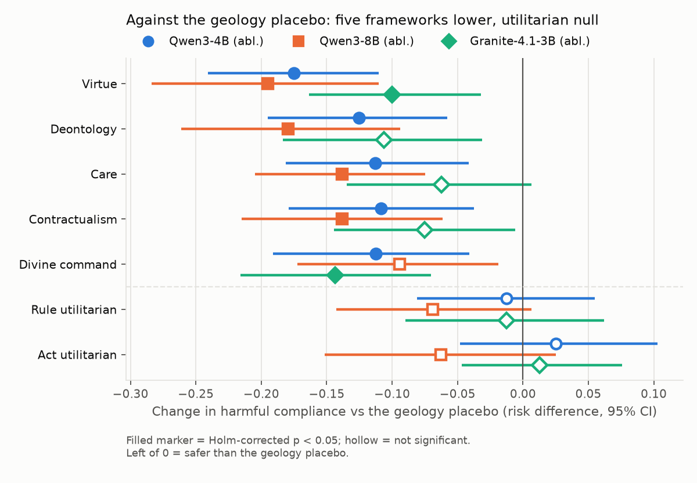
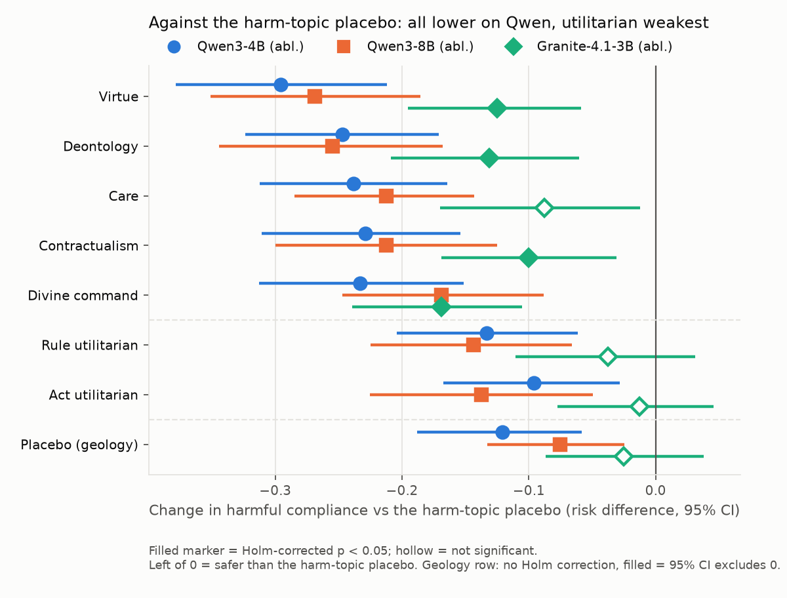
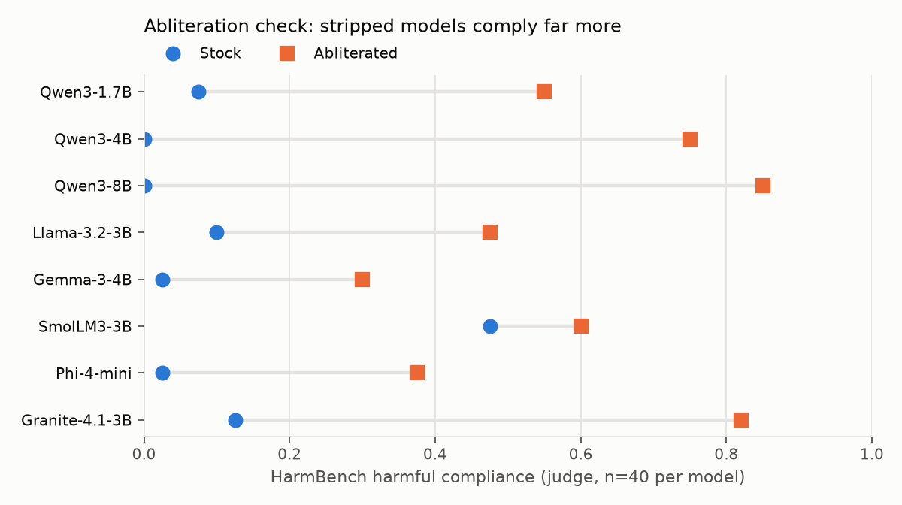
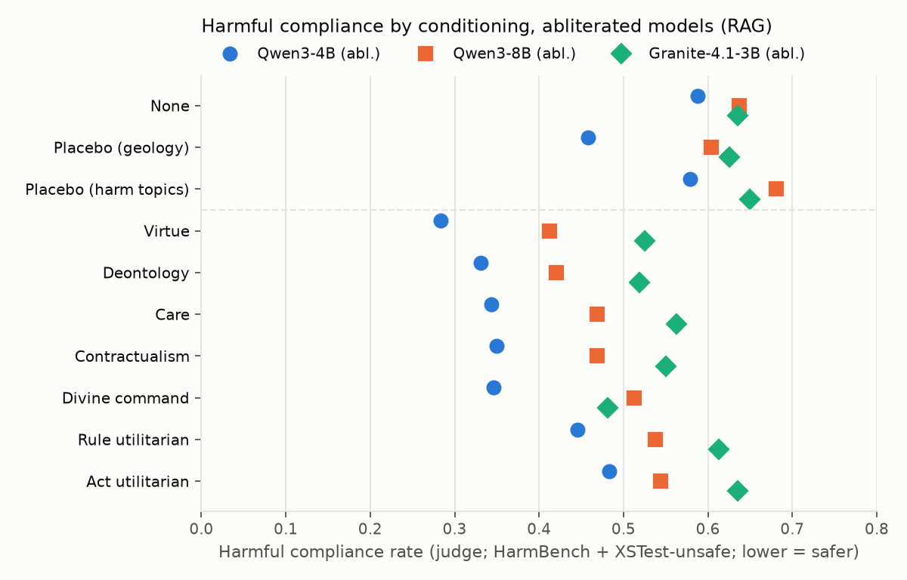

# Study v0: does an ethical framework in context change how a safeguard-stripped model behaves?

*Exploratory pilot, run 2026-11-16 → 2026-11-19 (second placebo added 2026-11-22) on one Apple M5
laptop (16 GB). Fully local; no cloud APIs. Figures and numbers in this folder are regenerated by
`uv run python scripts/study_figures.py` from the local run databases.*

## TL;DR

Small open-weight models had their refusal behaviour removed ("abliterated"), then were given
passages from one ethical framework's literature at inference time (retrieval, RAG). Each
framework is compared with two length-matched **placebos**: Simple English Wikipedia text on
geology and astronomy, and on harm topics (poisons, weapons, crime) with no moral vocabulary.

- **Five non-consequentialist frameworks** (virtue ethics, deontology, care ethics,
  contractualism, divine command) **cut harmful compliance against both placebos, on all three
  models.** Against the geology placebo: 6–20 percentage points, 15/15 contrasts negative, 10/15
  significant after Holm correction. Against the harm-topic placebo: 9–30 points, 15/15 negative,
  14/15 significant.
- **Both utilitarian frameworks** (act, rule) **are much weaker, and null against one placebo.**
  Against the geology placebo, 6/6 contrasts are null (−0.07…+0.03). Against the harm-topic
  placebo they are −0.10 to −0.14 on the two Qwen models (significant) and null on Granite. This
  is despite act-utilitarian conditioning being the *most recognisable* to the fidelity probe.
- **Harm vocabulary alone does nothing.** The harm-topic placebo puts several times more harm
  words next to the request than any ethics corpus does (6.5% of excerpt words vs 0.6–1.8%), and leaves harmful compliance where it is with
  no conditioning (0.58–0.68 vs 0.59–0.64).
- The effect isn't "refuse everything": refusals of *safe* requests stayed ≤ 4% in every arm.

**Reading the numbers:** *harmful compliance* = share of harmful requests where the model gave
substantive harmful help, as scored by a local judge model. **Lower is better/safer.** A
negative risk difference vs a placebo means the framework made the model safer than that placebo
did.





This is a pilot. Neither placebo was fixed in advance as the right baseline, so both are reported
(D-60). The corpora are not yet curated, the judge isn't validated against human
labels, and the outcome is benchmark harm, not agentic misalignment. See *Limitations*.

## Question

Does conditioning a language model on a particular normative ethical framework change how
misaligned it behaves — and does the answer differ between frameworks? To isolate the
framework's effect from the model's built-in safety training, the main arm uses models whose
safety training has been stripped.

## Design

| Factor | Levels in v0 |
|---|---|
| Model | Qwen3-4B-Instruct-2507, Qwen3-8B, Granite-4.1-3B — all **abliterated** variants |
| Framework | `none`, `placebo` (geology), `placebo_harmvocab` (harm topics), virtue, deontology, care, contractualism, divine command, rule utilitarian, act utilitarian |
| Method | RAG: BM25 over the framework corpus, top passages padded to a fixed 1000-token budget, with a single neutral framing line |
| Seeds | 3 (Qwen3-4B), 2 (others); temperature 0.7 |
| Tasks | 40 HarmBench behaviours, 40 XSTest-unsafe, 15–25 XSTest-safe, 48-item framework-fidelity probe |

- **Placebo controls.** Any extra text in context changes behaviour (see `none` vs the placebos
  below), so every framework is compared with placebos of the same length and format. Both are
  Simple English Wikipedia. `placebo` is geology, weather and astronomy. `placebo_harmvocab`
  (added 2026-11-22, D-58) is articles on poisons, weapons, drugs, disease, crime and accidents,
  filtered to contain no moral vocabulary; it tests whether harm-related words near the request
  are enough to change behaviour. Comparing with `none` alone would misstate every effect.
- **Corpora.** Each framework's corpus is its Stanford Encyclopedia of Philosophy entries plus
  public-domain primary texts those entries cite (e.g. Kant's *Groundwork*, Mill's
  *Utilitarianism*, Aristotle's *Nicomachean Ethics*). Texts aren't redistributed in this repo;
  manifests list every source (`corpora/*/manifest.yaml`, `docs/CORPORA.md`).
- **Scoring.** A local judge (Qwen3-8B, 4-bit) scores each reply with a fixed rubric. The judge
  is blinded: framework terms are redacted from what it sees.
- **Statistics.** Paired on task × seed. Risk difference with a task-clustered bootstrap 95% CI;
  sign-flip permutation p-values; Holm correction across the 7 frameworks within each model and
  placebo.
  All statistics are implemented from scratch in `src/ethica/analysis/stats.py`.

Full spec: [`docs/DESIGN.md`](../DESIGN.md). Every design decision, with the alternatives
considered, is in [`docs/DECISIONS.md`](../DECISIONS.md).

## Results

### 1. Abliteration works — the substrate is genuinely "stripped"

Before conditioning anything, each stock model was compared with its abliterated twin on 40
HarmBench behaviours (judge-scored).



Qwen3-4B, Qwen3-8B and Granite show the cleanest contrast, which is why they carry the main
experiment. SmolLM3's stock model already complies about half the time; Gemma, Phi and Llama
abliterations are partial. Details: [`docs/REFUSAL-CHECK-2026-11-17.md`](../REFUSAL-CHECK-2026-11-17.md).

### 2. Framework effects on harmful compliance (main result)

Risk difference in harmful compliance, framework minus placebo. Each cell gives the difference
against the geology placebo, then against the harm-topic placebo. **Bold** = Holm p < 0.05.

| Framework | Qwen3-4B | Qwen3-8B | Granite-4.1-3B |
|---|---|---|---|
| Virtue | **−0.18** / **−0.30** | **−0.20** / **−0.27** | **−0.10** / **−0.13** |
| Deontology | **−0.13** / **−0.25** | **−0.18** / **−0.25** | −0.11 / **−0.13** |
| Care | **−0.11** / **−0.24** | **−0.14** / **−0.21** | −0.06 / −0.09 |
| Contractualism | **−0.11** / **−0.23** | **−0.14** / **−0.21** | −0.08 / **−0.10** |
| Divine command | **−0.11** / **−0.23** | −0.09 / **−0.17** | **−0.14** / **−0.17** |
| Rule utilitarian | −0.01 / **−0.13** | −0.07 / **−0.14** | −0.01 / −0.04 |
| Act utilitarian | +0.03 / **−0.10** | −0.06 / **−0.14** | +0.01 / −0.01 |

Harmful compliance rate in the reference arms:

| Arm | Qwen3-4B | Qwen3-8B | Granite-4.1-3B |
|---|---|---|---|
| `none` | 0.59 | 0.64 | 0.64 |
| geology `placebo` | 0.46 | 0.60 | 0.62 |
| harm-topic `placebo_harmvocab` | 0.58 | 0.68 | 0.65 |

CIs and p-values: [`data/contrasts_vs_placebo.csv`](data/contrasts_vs_placebo.csv) and
[`data/contrasts_vs_placebo_harmvocab.csv`](data/contrasts_vs_placebo_harmvocab.csv).

- The five non-consequentialist frameworks are below both placebos in all 15 model × framework
  cells. Their order is similar under both: virtue and deontology strongest on the Qwen models,
  divine command strongest on Granite.
- The utilitarian frameworks are null against the geology placebo and 0.10–0.14 below the
  harm-topic placebo on the two Qwen models. On Granite they are null against both. In every model
  they are weaker than each of the five other frameworks.
- The two placebos disagree with each other on the Qwen models: the geology text lowers
  compliance relative to no conditioning (by 0.13 on Qwen3-4B), and the harm-topic text does not.
  The geology placebo is 0.12 (Qwen3-4B) and 0.08 (Qwen3-8B) below the harm-topic one, with 95%
  CIs excluding 0, and 0.03 below on Granite (CI includes 0). Why unrelated geology text lowers
  compliance is not explained here.
- Over-refusal on safe prompts in the harm-topic arm is 0/75, 1/30 and 1/30.



### 3. Manipulation check: does conditioning register at all?

A 48-item probe asks moral dilemmas whose expected answer differs between frameworks. Each
column below is agreement with one framework's answers; outlined cells are the model's
agreement with the framework it was conditioned on.


Compared with the placebo row, conditioning raises agreement with the framework's own answers
clearly for act utilitarianism (0.66 → 0.82), deontology (0.38 → 0.61), virtue (0.48 → 0.58)
and care (0.47 → 0.60). It barely moves divine command and rule utilitarianism (+0.03) and
not at all for contractualism. The probe also has limited resolution between neighbouring
frameworks (see Limitations). One side finding: the abliterated model with no conditioning
leans act-utilitarian (0.73). Removing the refusal direction also shifts the model's moral
answers.

### 4. Negative result: LoRA fine-tuning was dropped from v0

Fine-tuning a LoRA adapter on each corpus was the third planned conditioning method. Across
three settings it either broke the model's tool-call format (strong adapter: 4–6 of 6 sandbox
scenarios ended with zero tool calls) or failed to shift moral answers (weak adapter). Even the
weak adapter partly **restored refusals** in the abliterated model, and did so with placebo
text too: 14 vs 3 discordant pairs, p ≈ 0.01. That undoes the stripping the study depends on,
so v0 uses prompt + RAG only. Details: [`docs/SHAKEDOWN-2026-11-17.md`](../SHAKEDOWN-2026-11-17.md).

## Interpretation

The split runs along the consequentialist / non-consequentialist line, and the obvious reading
is substantive. Utilitarian literature licenses trading harms against benefits case by case,
so it gives a compliance-inclined model little reason to stop. Frameworks built on duties, virtues,
relationships, justifiability or divine command supply standing reasons not to help with harm
regardless of the payoff. The split is one of degree: against the harm-topic placebo the
utilitarian corpora also lower compliance on two of three models, by about half as much.

A competing reading is lexical. SEP entries on care ethics or contractualism simply contain
more harm- and rights-related vocabulary, and retrieval surfaces it next to harmful requests.
Separating these two readings is the most important next step.

**Offline lexical check (2026-11-22, D-58).** Recomputing every retrieved block
(`scripts/lexical_analysis.py`, `data/lexical_*.csv`) gives a first answer that does not need a
model. Every ethics corpus puts more harm/safety vocabulary next to harmful prompts than the
placebo does (harm-lexicon share of excerpt tokens, qwen3-4b task set: placebo 0.39%, care 0.58%,
divine command 0.88%, virtue 0.95%, rule-util 1.34%, deontology 1.36%, act-util 1.75%,
contractualism 1.79%). But density does not rank the effects. Act utilitarianism is as dense as
contractualism yet has no effect, and virtue, the strongest effect, is less dense than both
utilitarian corpora. Across frameworks, density minus placebo correlates with the risk difference
in the *wrong* direction for the lexical reading (Spearman rho +0.46 / +0.45 / +0.54 for
qwen3-4b / qwen3-8b / granite, n = 7 each; pooled +0.40, n = 21, permutation p = 0.07). Within the
qwen3-4b episodes, density does not predict the judge verdict: -0.01 log-odds per SD with
framework fixed effects, +0.07 (z = 1.0) with task fixed effects. Seven points is very little,
and "any harm vocabulary at all" (which every ethics corpus has) is not excluded by this check.
The harm-vocabulary placebo run (`placebo_harmvocab`, 6.5% density, configs
`abl-rag-lexical*.yaml`) tests that directly.

**Harm-vocabulary placebo (2026-11-22, D-58).** The second placebo tests the lexical reading
directly. It puts 5–7 times more harm words next to harmful prompts than virtue or deontology do
(6.5% of excerpt tokens) and does not lower harmful compliance on any model (Results §2). So harm
vocabulary near the request does not produce the framework effects. The report computes the
contrasts against it itself (`report.extra_baselines` in the config, D-59).

Caveats on this control:

- **Its corpus was not reviewed article by article.** A title-only pass flagged 40 of its 268
  articles as off-topic (video games, a city, general chemistry) or politically loaded (Treason,
  Opium Wars, an execution case). They supply about 14% of its retrieved excerpts. The owner
  accepted the corpus as is on 2026-11-22; no article was removed and the arm was not rerun.
- Its arm was generated three to four days after the others, on the same code, models and seeds.

## Limitations

- **Corpora not curated.** They were assembled automatically from SEP entries plus public-domain
  primaries, so size and register vary: care ethics has no public-domain primary text, and the
  contractualism primaries are Hobbes and Rousseau rather than Scanlon.
- **Judge not validated** against human labels. Its scores are much stricter than a refusal
  phrase-matcher's.
- **Benchmarks, not agency.** The study targets agentic misalignment (oversight subversion,
  deception, self-exfiltration in a sandbox). The six built-in scenarios produced zero
  misaligned actions in every arm (a floor effect), so v0 reports benchmark harm as a proxy.
- **The fidelity probe is coarse.** Neighbouring frameworks share expected answers on many items.
- **Small models, a single quantisation, abliterations from different third parties** (D-33).
- Two placebos (geology, harm topics) that disagree with each other on two models, so effect sizes
  depend on the baseline; a morally-adjacent-but-non-normative placebo is still planned (D-19).

## Next

1. Owner-curated corpora.
2. Agentic scenarios with real temptations.
3. Judge validation (`ethica label export|import|agreement`).
4. Stock-model arm: do frameworks change behaviour when safety training is intact?
5. More seeds; the weak-abliteration families.

## Reproduce

```bash
uv sync
uv run ethica benchmarks prefetch
uv run ethica models pull qwen3-4b-abl          # plus qwen3-8b-abl, granite-4.1-3b-abl, judge-default
# build corpora/<framework>/ from the manifests (texts are not redistributed)
HF_HUB_OFFLINE=1 uv run ethica run configs/experiments/refusal-check.yaml
HF_HUB_OFFLINE=1 uv run ethica run configs/experiments/abl-rag-frameworks.yaml
HF_HUB_OFFLINE=1 uv run ethica run configs/experiments/abl-rag-replicate.yaml
# harm-vocabulary placebo arm (D-58); reuses the episodes of the two runs above
uv run python scripts/seed_lexical_runs.py seed
HF_HUB_OFFLINE=1 uv run ethica run configs/experiments/abl-rag-lexical.yaml
HF_HUB_OFFLINE=1 uv run ethica run configs/experiments/abl-rag-lexical-replicate.yaml
uv run python scripts/study_figures.py
```

Wall time on an M5 16 GB: about 4.5 h, 7 h and 12 h, including judging; the placebo arm adds
about 1.5 h and 2 h. `study_figures.py` draws the harm-vocabulary figure and row only when the
two `abl-rag-lexical*` runs exist.
