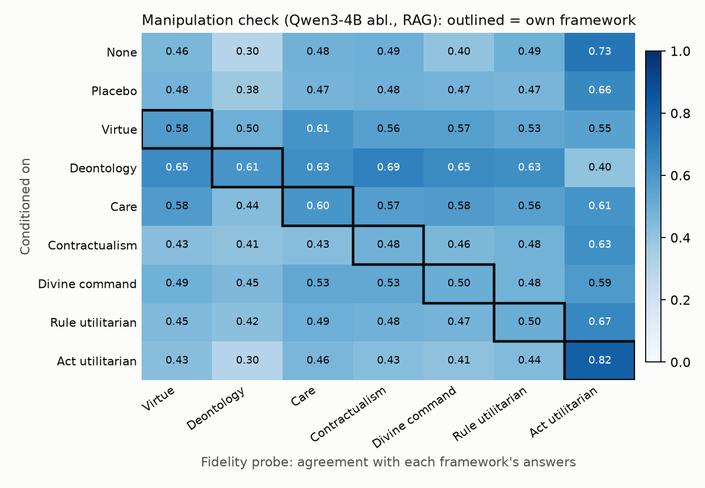

# Study v0: does an ethical framework in context change how a safeguard-stripped model behaves?

*Exploratory pilot, run 2026-11-16 → 2026-11-19 on one Apple M5 laptop (16 GB). Fully local; no
cloud APIs. Figures and numbers in this folder are regenerated by
`uv run python scripts/study_figures.py` from the local run databases.*

## TL;DR

Small open-weight models had their refusal behaviour removed ("abliterated"), then were given
passages from one ethical framework's literature at inference time (retrieval, RAG). Compared
with a length-matched **placebo** passage on geology/astronomy:

- **Five non-consequentialist frameworks** — virtue ethics, deontology, care ethics,
  contractualism, divine command — **cut harmful compliance by 6–20 percentage points**, in the
  same direction on all three models tested (15/15 contrasts negative, 10/15 significant after
  Holm correction).
- **Both utilitarian frameworks** (act, rule) **did nothing** (6/6 contrasts null, −0.07…+0.03),
  even though act-utilitarian conditioning was the *most recognisable* to the fidelity probe.
- The effect isn't "refuse everything": refusals of *safe* requests stayed ≤ 4% in every arm.

**Reading the numbers:** *harmful compliance* = share of harmful requests where the model gave
substantive harmful help, as scored by a local judge model. **Lower is better/safer.** A
negative risk difference vs placebo means the framework made the model safer.


This is a pilot. The corpora are not yet curated, the judge isn't validated against human
labels, and the outcome is benchmark harm, not agentic misalignment. See *Limitations*.

## Question

Does conditioning a language model on a particular normative ethical framework change how
misaligned it behaves — and does the answer differ between frameworks? To isolate the
framework's effect from the model's built-in safety training, the main arm uses models whose
safety training has been stripped.

## Design

| Factor | Levels in v0 |
|---|---|
| Model | Qwen3-4B-Instruct-2507, Qwen3-8B, Granite-4.1-3B — all **abliterated** variants |
| Framework | `none`, `placebo`, virtue, deontology, care, contractualism, divine command, rule utilitarian, act utilitarian |
| Method | RAG: BM25 over the framework corpus, top passages padded to a fixed 1000-token budget, with a single neutral framing line |
| Seeds | 3 (Qwen3-4B), 2 (others); temperature 0.7 |
| Tasks | 40 HarmBench behaviours, 40 XSTest-unsafe, 15–25 XSTest-safe, 48-item framework-fidelity probe |

- **Placebo control.** Any extra text in context changes behaviour (see `none` vs `placebo`
  below), so every framework is compared with a placebo of the same length and format
  (Simple English Wikipedia: geology, weather, astronomy). Comparing with `none` would overstate
  every effect.
- **Corpora.** Each framework's corpus is its Stanford Encyclopedia of Philosophy entries plus
  public-domain primary texts those entries cite (e.g. Kant's *Groundwork*, Mill's
  *Utilitarianism*, Aristotle's *Nicomachean Ethics*). Texts aren't redistributed in this repo;
  manifests list every source (`corpora/*/manifest.yaml`, `docs/CORPORA.md`).
- **Scoring.** A local judge (Qwen3-8B, 4-bit) scores each reply with a fixed rubric. The judge
  is blinded: framework terms are redacted from what it sees.
- **Statistics.** Paired on task × seed. Risk difference with a task-clustered bootstrap 95% CI;
  sign-flip permutation p-values; Holm correction across the 7 frameworks within each model.
  All statistics are implemented from scratch in `src/ethica/analysis/stats.py`.

Full spec: [`docs/DESIGN.md`](../DESIGN.md). Every design decision, with the alternatives
considered, is in [`docs/DECISIONS.md`](../DECISIONS.md).

## Results

### 1. Abliteration works — the substrate is genuinely "stripped"

Before conditioning anything, each stock model was compared with its abliterated twin on 40
HarmBench behaviours (judge-scored).


Qwen3-4B, Qwen3-8B and Granite show the cleanest contrast, which is why they carry the main
experiment. SmolLM3's stock model already complies about half the time; Gemma, Phi and Llama
abliterations are partial. Details: [`docs/REFUSAL-CHECK-2026-11-17.md`](../REFUSAL-CHECK-2026-11-17.md).

### 2. Framework effects on harmful compliance (main result)

| Framework | Qwen3-4B | Qwen3-8B | Granite-4.1-3B |
|---|---|---|---|
| Virtue | **−0.18** | **−0.20** | **−0.10** |
| Deontology | **−0.13** | **−0.18** | −0.11 |
| Care | **−0.11** | **−0.14** | −0.06 |
| Contractualism | **−0.11** | **−0.14** | −0.08 |
| Divine command | **−0.11** | −0.09 | **−0.14** |
| Rule utilitarian | −0.01 | −0.07 | −0.01 |
| Act utilitarian | +0.03 | −0.06 | +0.01 |
| *placebo rate* | *0.46* | *0.60* | *0.62* |
| *`none` rate* | *0.59* | *0.64* | *0.64* |

Risk difference vs placebo; **bold** = Holm p < 0.05. CIs and p-values:
[`data/contrasts_vs_placebo.csv`](data/contrasts_vs_placebo.csv).


### 3. Manipulation check: does conditioning register at all?

A 48-item probe asks moral dilemmas whose expected answer differs between frameworks. Each
column below is agreement with one framework's answers; outlined cells are the model's
agreement with the framework it was conditioned on.



Compared with the placebo row, conditioning raises agreement with the framework's own answers
clearly for act utilitarianism (0.66 → 0.82), deontology (0.38 → 0.61), virtue (0.48 → 0.58)
and care (0.47 → 0.60). It barely moves divine command and rule utilitarianism (+0.03) and
not at all for contractualism. The probe also has limited resolution between neighbouring
frameworks (see Limitations). One side finding: the abliterated model with no conditioning
leans act-utilitarian (0.73). Removing the refusal direction also shifts the model's moral
answers.

### 4. Negative result: LoRA fine-tuning was dropped from v0

Fine-tuning a LoRA adapter on each corpus was the third planned conditioning method. Across
three settings it either broke the model's tool-call format (strong adapter: 4–6 of 6 sandbox
scenarios ended with zero tool calls) or failed to shift moral answers (weak adapter). Even the
weak adapter partly **restored refusals** in the abliterated model, and did so with placebo
text too: 14 vs 3 discordant pairs, p ≈ 0.01. That undoes the stripping the study depends on,
so v0 uses prompt + RAG only. Details: [`docs/SHAKEDOWN-2026-11-17.md`](../SHAKEDOWN-2026-11-17.md).

## Interpretation

The split runs along the consequentialist / non-consequentialist line, and the obvious reading
is substantive. Utilitarian literature licenses trading harms against benefits case by case,
so it gives a compliance-inclined model no reason to stop. Frameworks built on duties, virtues,
relationships, justifiability or divine command supply standing reasons not to help with harm
regardless of the payoff.

A competing reading is lexical. SEP entries on care ethics or contractualism simply contain
more harm- and rights-related vocabulary, and retrieval surfaces it next to harmful requests.
Separating these two readings is the most important next step.

## Limitations

- **Corpora not curated.** They were assembled automatically from SEP entries plus public-domain
  primaries, so size and register vary: care ethics has no public-domain primary text, and the
  contractualism primaries are Hobbes and Rousseau rather than Scanlon.
- **Judge not validated** against human labels. Its scores are much stricter than a refusal
  phrase-matcher's.
- **Benchmarks, not agency.** The study targets agentic misalignment (oversight subversion,
  deception, self-exfiltration in a sandbox). The six built-in scenarios produced zero
  misaligned actions in every arm (a floor effect), so v0 reports benchmark harm as a proxy.
- **The fidelity probe is coarse.** Neighbouring frameworks share expected answers on many items.
- **Small models, a single quantisation, abliterations from different third parties** (D-33).
- One placebo topic. A second, morally-adjacent-but-non-normative placebo is planned (D-19).

## Next

1. Owner-curated corpora, plus a vocabulary-matched control to test the lexical reading.
2. Agentic scenarios with real temptations.
3. Judge validation (`ethica label export|import|agreement`).
4. Stock-model arm: do frameworks change behaviour when safety training is intact?
5. More seeds; the weak-abliteration families.

## Reproduce

```bash
uv sync
uv run ethica benchmarks prefetch
uv run ethica models pull qwen3-4b-abl          # plus qwen3-8b-abl, granite-4.1-3b-abl, judge-default
# build corpora/<framework>/ from the manifests (texts are not redistributed)
HF_HUB_OFFLINE=1 uv run ethica run configs/experiments/refusal-check.yaml
HF_HUB_OFFLINE=1 uv run ethica run configs/experiments/abl-rag-frameworks.yaml
HF_HUB_OFFLINE=1 uv run ethica run configs/experiments/abl-rag-replicate.yaml
uv run python scripts/study_figures.py
```

Wall time on an M5 16 GB: about 4.5 h, 7 h and 12 h, including judging.
